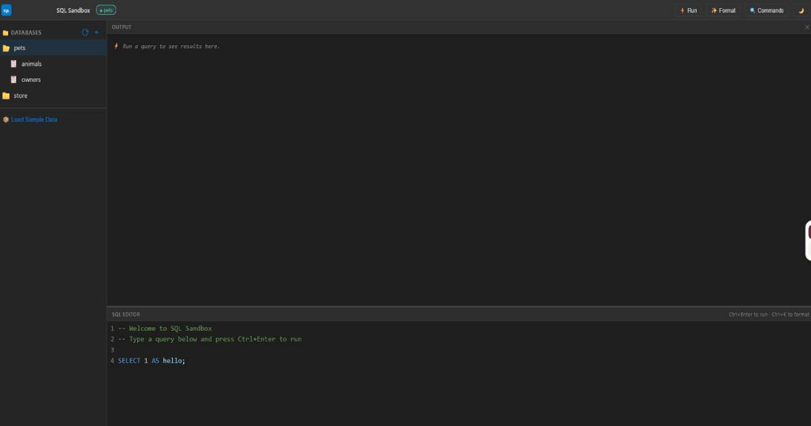

# SQL Sandbox

A responsive, browser-based learning system for anyone who wants to learn SQL. No installation, no server — everything runs in your browser using WebAssembly.



**Current version: 1.1.0**

## What's New in 1.1

### ♿ Accessibility improvements (from user feedback)

Based on feedback from users, I made a round of accessibility changes so the app is easier to read and to use with a keyboard:

- **Color contrast meets WCAG 2.2 AA in both themes.** An audit found 37 text/background pairs below the minimum contrast. All of them are fixed: mainly blue link text, gray secondary text, faint input borders, and status colors that were built for dark mode and hard to read in light mode. Run `npm run audit:contrast` to recheck all 82 pairs.
- **Clear text labels instead of icon-only buttons:** *Refresh*, *Add New Database*, and *CLEAR* on both the Output and SQL Editor panels.
- **Keyboard support:** database and table rows can be reached with Tab and opened with Enter, and their action buttons (new table, delete) can now be reached by keyboard too. The panel divider resizes with the arrow keys, and focus outlines are visible throughout.
- **Accessible dialogs:** confirmations and prompts are in-app dialogs that respond to Enter and Escape and return focus where you left off. Fields in the Create Table window have proper labels for screen readers.

### ✨ New features

- ⚙️ **Settings window:** switch between light and dark mode, and lay out the Output and SQL Editor panels **stacked** or **side by side**, in either order.
- ↕️ **Resizable panels:** drag the divider between the Output and Editor (or use the arrow keys).
- 🧹 **CLEAR buttons** for both the Output and the SQL Editor (Ctrl+Z undoes an editor clear).
- 📥 **Import Data:** open a `.sqlite` / `.db` file, run a `.sql` script into a new database, or turn a `.csv` file into a table with automatic column types.

### 🐛 Bug fixes

- *Add New Database* did nothing in the desktop (Electron) app, which doesn't support browser `prompt()` pop-ups.
- A deleted database stayed in the sidebar until the next refresh.
- Typing in the Create Table window lost focus after every keystroke.
- Adding a table to a database that wasn't open showed that table under the wrong database.
- Switching themes erased the editor's undo history.
- Column names containing spaces produced invalid `CREATE TABLE` SQL.
- The panel divider showed a resize cursor but couldn't be dragged.

## Features

- 🗄️ **Database Management**: Create, select, and delete databases (real SQLite via WebAssembly).
- 📋 **Table Management**: Create tables with constraints (PK, FK, Unique, Not Null), inspect columns, and drop tables.
- 📊 **Interactive SQL Schema & ER Diagram**:
  - Live Mermaid ER diagram generation with automatic relationship mapping.
  - Visual connecting lines from the database root to all tables, plus table-to-table foreign keys.
  - Supabase-style interactive Table Cards view with PK, FK, and UK badges.
  - Exportable, copy-ready Mermaid syntax for Mermaid Live Editor, GitHub Markdown, Obsidian, and Notion.
  - Resizable and maximizable modal window with dynamic auto-scaling and accent-colored scrollbars.
  - Interactive pan & zoom navigation: click and drag anywhere inside the window to move the schema, mouse wheel to zoom in and out centered on cursor, and toolbar zoom buttons (`+`, `−`, `Fit`).
  - Active table relationship highlighting: displays distinctive amber lines and markers for all relationships connected to the active table (switchable via toolbar dropdown, clicking visual diagram nodes, or selecting table cards).
- 💻 **VS Code–Style Interface**: Collapsible sidebar, CodeMirror 6 SQL editor with syntax highlighting, and an output terminal panel.
- ✨ **One-Click SQL Formatting**: Beautify and standardize SQL queries (Ctrl+K).
- 🔍 **Command Search & Palette**: Quick command search (Ctrl+Shift+P) with syntax examples, copy shortcuts, and one-click editor insertion.
- 💾 **Client-Side Persistence**: Saves databases and state directly in your browser using localStorage / IndexedDB.
- 🌙 **Theme & Layout Settings**: Dark and Light modes, with stacked or side-by-side panels in either order.
- 📥 **Import Data**: Import SQLite databases, `.sql` scripts, and CSV files.
- ♿ **Accessible**: WCAG AA color contrast in both themes and full keyboard navigation.
- 🖥️ **Desktop App**: Also available as a Windows desktop app built with Electron.

## Getting Started

```bash
# Install dependencies
npm install

# Start local development server
npm run dev

# Run unit test suite
npm test

# Check text/background color contrast (WCAG AA) for both themes
npm run audit:contrast

# Run the desktop (Electron) app
npm run electron

# Build the Windows installer
npm run dist

# Build for production
npm run build

# Preview production build locally
npm run preview
```

## Tech Stack

- **Vite** — Fast frontend build tool
- **sql.js** — SQLite compiled to WebAssembly (WASM)
- **CodeMirror 6** — Modern, extensible in-browser code editor
- **Mermaid.js** — Diagramming and visual ER relationship rendering
- **sql-formatter** — SQL prettifier and dialect formatting
- **Tailwind CSS** — Modern styling and layout utilities

## Social & Links

- 🌐 [Website](https://codeboxllc.net/)
- 💼 [LinkedIn](https://www.linkedin.com/in/damion-coder-wilson)
- 🦋 [Bluesky](https://bsky.app/profile/dwilsoncoder.bsky.social)
- 🐙 [GitHub](https://github.com/dwilson-coder/sqlsandbox.git)

Built with ❤️ by Damion Wilson for [CodeBox LLC](https://codeboxllc.net/).
